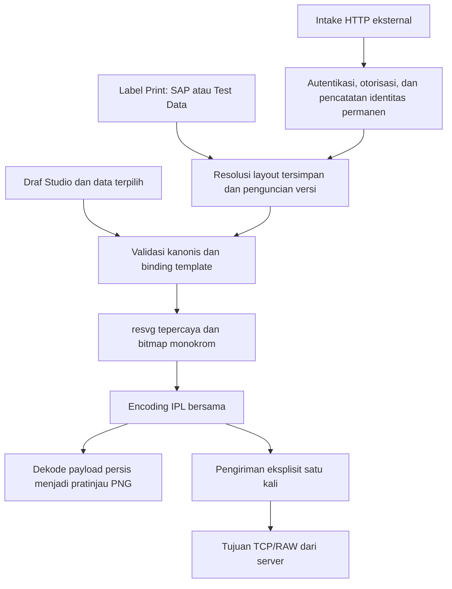

# Panduan utama proyek Thermal Label Studio

Tanggal tinjauan source: **17 Oktober 2026 (Asia/Jakarta)**. Cakupan: working tree
lokal aktif, termasuk implementasi yang telah ada dan belum di-commit. Dokumen ini
menjelaskan perilaku source serta batas operasional; isinya tidak membuktikan
kesehatan layanan saat ini. Rujukan kontrak tersedia di [indeks dokumentasi](README.md).
Dokumen ini menggunakan Bahasa Indonesia sesuai permintaan pengguna. Nama teknis,
path, key data, perintah, serta kode status dipertahankan persis.

## 1. Tujuan dan cakupan

Thermal Label Studio digunakan untuk mendesain label SVG, mengikat nilai bisnis
kanonis secara persis ke template, menghasilkan output monokrom, menampilkan
pratinjau hasil dekode IPL, serta mengirim pekerjaan yang dipilih secara eksplisit
melalui TCP/RAW. PostgreSQL dan MinIO menyediakan penyimpanan template berversi.
Aplikasi juga mengelola dataset contoh, gambar, sumber integrasi, tujuan printer,
dan operasi SAP RFC yang dapat dikonfigurasi.

Repositori aktif adalah `Thermal-Label-Studio/`, terpisah dari repositori induk
workspace. `web_app`, direktori arsip saudara, dan `.archive/` merupakan referensi
historis. SAP-Simulator adalah pengirim terpisah. Paket `local_agent/` berdiri
sendiri dan tidak menjadi prasyarat pengiriman LAN normal di Label Print. Aset
`engine/` pada root tidak menggantikan implementasi backend aktif di
`backend/app/engine/`.

Studio memiliki login akun lokal, sesi server, dan peran Admin/Designer/Operator.
Lihat [kontrak login](AUTH_CONTRACT.md) untuk provisioning, bootstrap, pemulihan
Admin, dan konfigurasi HTTPS. Login browser dan bearer intake tetap terpisah. Deployment
bersama, operasional produksi, penegakan batas sumber daya secara menyeluruh,
integrasi ECC yang aktif, dan penerimaan printer fisik masih memerlukan pekerjaan
atau bukti tambahan.

## 2. Halaman aplikasi

| URL | Kegunaan dan tanggung jawab | Source utama |
| --- | --- | --- |
| `/` | Menu aktivitas dan preferensi bersama | `frontend/src/features/home/` |
| `/studio` | Desain template, eksplorasi JSON, Save/Open, Preview, dan Print dari editor | `frontend/src/features/studio/` |
| `/print` | Input batch, pengambilan SAP/Test Data, pemilihan pratinjau, dan LAN Print ke printer terdaftar | `frontend/src/features/label-print/` |
| `/management` | Konfigurasi, data/aset yang dapat dipakai ulang, integrasi, audit, dan riwayat operasional | `frontend/src/features/management/` |
| `/fixture-simulation` | Diagnostik menggunakan fixture sintetis | `frontend/src/features/simulation/` |

`frontend/src/app/routes.tsx` memuat halaman secara lazy. Path klien yang tidak
dikenal menampilkan halaman tidak ditemukan. Home dan Print tidak memuat editor
atau diagnostik Studio. Preferences mengatur bahasa serta tema; preferensi tersebut
tidak menerjemahkan key SAP, teks label yang dibuat, isi barcode, atau piksel output.

Management saat ini memuat Overview, Test Data, Graphics, Templates, Printers,
Integrations, Audit Log, dan Activity Log. Penyimpanan kebijakan yang dapat diubah
harus diaktifkan secara eksplisit. Test Data dan Graphics memiliki batas
penyimpanan masing-masing. Printer yang terdaftar atau diaktifkan belum menjadi
bukti konektivitas maupun kesiapan perangkat.

## 3. Arsitektur dan tanggung jawab modul

| Penanggung jawab | Tanggung jawab |
| --- | --- |
| `backend/app/main.py` | Komposisi FastAPI, siklus hidup, middleware, health/readiness, dan penerimaan permintaan fixture |
| `label_data/` | Envelope/skalar kanonis, makna key persis, dan penulisan angka |
| `template_binding/` | Validasi metadata SVG, teks/komposisi, pembuatan ulang simbol, dan placeholder |
| `engine/` | Output siap pakai yang tidak diubah, rasterisasi, pemrosesan monokrom, dan encoding IPL |
| `simulation/` | Dekode IPL yang telah disiapkan menjadi pratinjau serta output fixture sintetis |
| `printing/` | Validasi tujuan tindakan Studio dan pengiriman TCP satu kali |
| `label_print/` | Pratinjau batch berurutan, resolusi data tersimpan/SAP, cache artefak, pengiriman LAN, dan pemeriksaan status eksplisit |
| `layouts/` | Metadata berversi di PostgreSQL serta SVG yang tidak diubah di MinIO |
| `studio_datasets/`, `graphics/` | Data contoh kanonis yang dapat dipakai ulang serta aset gambar tetap |
| `label_intake/` | Kebijakan sumber, identitas permanen, versi yang dikunci, replay, klaim pengiriman, dan eksekusi eksternal |
| `management/` | Konfigurasi dengan pemeriksaan revisi, pengelolaan sumber/key/printer/RFC, dan audit |
| `sap_rfc/` | Kontrak input/hasil RFC dan batas worker native yang diaktifkan eksplisit |
| `activity/`, `observability.py` | Riwayat operasional best-effort serta korelasi permintaan dengan data terbatas |
| `jobs/`, `sap/` | Fondasi yang dipertahankan; keberadaannya tidak membuktikan alur SAP/job langsung telah terhubung |

Setiap fitur frontend memiliki klien API, model, hook, dan UI sendiri. `shared/`
memiliki fasilitas UI, i18n, keyboard, dan API lintas fitur. Impor/ekspor kanvas
Fabric berada di `features/canvas/`; state editor bersama tetap berada dalam
store pada root. Ekspor publik fitur menjadi batas akses modul dari luar.
Token CSS di `index.css` mengatur tampilan aplikasi tanpa mengubah geometri
SVG/Fabric yang dibuat pengguna.

## 4. Tiga alur output

| Aspek | Studio | Label Print | Intake eksternal |
| --- | --- | --- | --- |
| Input | Draf aktif yang belum disimpan dan data terpilih | Batch berurutan dengan sumber SAP atau Test Data tersimpan yang dipilih eksplisit | Envelope HTTP kanonis yang diautentikasi |
| Template | Ekspor kanvas saat ini | Layout tersimpan dengan versi dikunci ketika menyiapkan pratinjau | Versi layout tetap yang dipertahankan bersama identitas |
| Tujuan | IP numerik/port per tindakan; konfigurasi server dapat menjadi cadangan | Tujuan Management yang aktif; alamat yang diharapkan mendeteksi UI kedaluwarsa | Default sumber atau `target_id` logis yang diizinkan; alamat tetap milik server |
| Pratinjau | IPL bersama yang didekode menjadi PNG | Bitmap siap pakai dan artefak sementara dengan batas kapasitas/waktu | Hasil simulasi disimpan melalui ledger permanen |
| Cetak | Satu tindakan eksplisit, copies 1..999 | Artefak terpilih dikirim berurutan; berhenti pada kegagalan pertama | Pemeriksaan awal seluruh item, klaim permanen sebelum efek ke perangkat |
| Perlindungan pengulangan | Penanganan ketidakpastian di browser; tanpa ledger intake | Kunci ketidakpastian per tab dan artefak sementara; tanpa ledger job LAN permanen | Pengirim dan request ID, digest/HMAC kanonis, replay hasil akhir, dan tombstone |

Ketiganya memakai binder dan mesin output bersama. Demo tidak mengeksekusi SAP
atau transport printer. Test Data merupakan input nyata ke pipeline: mencetak
pratinjaunya secara eksplisit dapat menghubungi printer fisik. Demo hanya
menyimulasikan perilaku tersebut.

`SUBMITTED` dan `confirmed=false` menunjukkan penyerahan ke transport. Status ini
belum membuktikan label telah keluar, media benar, barcode terbaca, atau proses
fisik selesai. Pengiriman yang tidak pasti memerlukan pemeriksaan. Kesalahan HTTP
saja tidak membuktikan bahwa tidak ada byte yang mencapai perangkat.

### Alur operator Studio

1. Buka Studio dan atur media fisik/DPI. Tambahkan teks, bentuk, gambar, serta
   barcode/QR yang didukung. SVG impor wajib memenuhi aturan keamanan dan metadata.
2. Impor atau telusuri JSON kanonis, lalu pilih item data. Hubungkan field persis
   atau komposisi literal/token; deskripsi tampilan hanya untuk penyajian.
3. Simpan versi dengan kode label persis seperti yang ditulis, atau lanjutkan
   draf tanpa menyimpan. Save/Open memerlukan konfigurasi penyimpanan layout;
   pratinjau draf yang belum disimpan tidak memerlukannya.
4. Gunakan Preview atau Label Simulation. Keduanya memanggil API editor-preview
   dan menampilkan hasil dekode IPL bersama. Metadata/isi yang tidak valid
   ditolak sebelum transport.
5. Untuk tindakan perangkat yang telah diizinkan, pilih Print, periksa IP/port
   dan copies, lalu kirim secara eksplisit. Membuka atau mengedit dialog tidak
   membuat koneksi perangkat. Setelah kegagalan yang tidak pasti, periksa perangkat
   sebelum membuka kembali dialog untuk tindakan berikutnya.

Rename/Delete merupakan perubahan Management yang diaudit. Artefak versi tetap
dan hasil penyimpanan yang ambigu harus dipertahankan. Penyisipan gambar menanamkan
salinan; perubahan pustaka berikutnya tidak mengganti gambar dalam template lama.

### Alur operator Label Print

1. Masukkan batch satu per satu atau tempel satu kolom; selesaikan peringatan duplikat.
2. Pilih SAP atau Test Data. SAP memerlukan operasi `label_json` tersimpan yang
   aktif serta runtime native terkonfigurasi. Test Data memerlukan dataset dan
   layout tersimpan.
3. Get Data menyiapkan pratinjau per item. Periksa kesalahan setiap item: HTTP 200
   masih dapat berisi hasil FAILED/PARTIAL. Kegagalan SAP tidak otomatis beralih
   ke Test Data. Respons browser yang terlambat atau tidak lagi relevan diabaikan.
4. Pilih pratinjau yang berhasil, printer terdaftar yang aktif, dan copies. Print
   memakai ulang bitmap hasil binding tanpa mengambil SAP atau meraster ulang.
   Perubahan jumlah salinan dapat melakukan encoding IPL ulang dari bitmap yang sama.
5. Kirim secara eksplisit. Server memeriksa kembali identitas/alamat tujuan dan
   artefak, mengirim satu kali per item terpilih, lalu berhenti ketika gagal.
   Item yang belum dicoba tetap dibedakan. Hasil parsial/tidak pasti mengunci
   pencetakan di browser sampai ditinjau operator.

Cache artefak berada dalam proses aplikasi, dengan default 900 detik, 64 MiB,
dan maksimal 256 entri (`label_print/artifacts.py`). Kedaluwarsa, pengeluaran dari
cache, atau restart proses dapat mengharuskan pengambilan data ulang. Cache ini
bukan penyimpanan job permanen.

Check status merupakan tindakan eksplisit terpisah: satu kueri IPL ENQ ke tujuan
terdaftar yang divalidasi ulang, dijalankan bergantian dengan LAN Print. Pemilihan
printer, startup, dan Demo tidak melakukan probe. Respons yang dikenali merupakan
snapshot, termasuk keadaan ambigu ready/printing/skipping; respons tersebut tidak
mengonfirmasi penyelesaian atau membuka kunci job yang tidak pasti. Kegagalan
koneksi tidak membuktikan perangkat mati. SNMP belum diimplementasikan.

### Alur pengirim eksternal

Buat dan simpan satu transaksi logis tetap sebelum mengirim. Pertahankan
`sender.system`, `request_id`, items, copies, tujuan, dan payload yang persis sama
ketika mencoba ulang. Menggunakan ID yang sama dengan isi berubah menimbulkan
konflik. Transaksi baru yang disengaja memerlukan ID baru. Nomor batch dan ID
penelusuran HTTP merupakan identitas berbeda.

Intake memerlukan kredensial eksplisit, mode yang diizinkan, layout tersimpan
valid, izin routing/jumlah salinan sumber, serta ledger permanen terkonfigurasi.
Sumber saat ini dapat memakai semua template valid untuk mode yang diizinkan:
pembatasan kode per sumber dan syarat persetujuan lama telah digantikan keputusan
baru. Layout yang tidak dikenal tetap ditolak.

`target_id` opsional pada tingkat teratas hanya berlaku untuk print, harus diizinkan
bagi sumber, dan tidak dapat menyediakan IP/port. Jika dihilangkan, default sumber
dan bentuk digest historis dipertahankan. Perubahan kebijakan/tujuan divalidasi
kembali sebelum klaim; permintaan tersimpan tidak dialihkan diam-diam. Lihat
[identitas permintaan](REQUEST_ID_CONTRACT.md) dan [kontrak API](API_CONTRACT.md)
untuk makna replay serta kesalahan secara persis.

## 5. Kontrak data dan template

Envelope kanonis berisi `sender:{system}`, `request_id`, `mode`, serta array
`items` berurutan. Setiap item berisi `item_id`, `label_code`, `copies`, dan objek
`data` dengan nilai skalar datar. `field_descriptions` merupakan metadata tampilan
opsional; `target_id` opsional hanya untuk print. [Data contoh](examples/label_data.sample.json)
merupakan contoh, bukan transaksi operasional yang dikirim ulang tanpa perubahan.

Pertahankan kapitalisasi kode label dan key teknis SAP persis. Jangan melakukan
trim, mengubah ke huruf besar, menambahkan padding, atau menebak alias. Input
kanonis menolak nilai field bertingkat, anggota JSON duplikat, key tidak aman,
dan tipe tidak valid. Angka nol, boolean false, whitespace, string kosong, null,
dan key yang tidak ada harus dibedakan. Nilai SAP berawalan nol harus tetap string.
Deskripsi tidak menjadi nilai data atau sumber kebenaran binding.

| Nilai yang diikat | Output teks | Output barcode/QR |
| --- | --- | --- |
| Key tidak ada | `N/A` | Kotak bergaris dengan ` N/A ` di tengah |
| Null atau string kosong yang memang ada | ` - ` termasuk spasi di kedua sisi | Placeholder polos yang sama |
| Nol / false / whitespace | Nilai kanonis dipertahankan | Isi sebenarnya divalidasi terhadap profil simbol yang dideklarasikan |
| Isi tidak kosong tetapi tidak valid | Ditolak jika diwajibkan profil | Ditolak; tidak memakai contoh lama atau jenis simbol lain |

Nilai pengganti hanya mengubah output; data mentah dan identitas permintaan tetap.
Simbol dengan salah satu token sumber tidak tersedia tidak mengodekan teks parsial
atau teks pengganti.

Binding versi 1 mendukung teks dinamis polos dengan batas yang ditentukan,
komposisi literal/token, Code128, Code39, EAN13, serta QR dengan opsi eksplisit.
Media root memakai mm dan empat unit kanvas per mm. Batas binding standar meliputi
10..500 mm, 72..600 DPI, 4096 dot per sisi, dan empat juta piksel output. Keamanan
SVG serta metadata memiliki batas tersendiri. Rich text dinamis, Textbox dengan
pembungkusan otomatis, shaping/font yang tidak didukung, dimensi pecahan generator
linear, dan profil lama tanpa deklarasi lengkap ditolak secara fail-closed.
Tidak ada migrasi template tersimpan otomatis atau eksekusi kode buatan pengguna.
[Kontrak binding](TEMPLATE_BINDING_CONTRACT.md) menentukan profil dan batas persis.

## 6. Penyimpanan dan siklus hidup

| Data | Penyimpanan / penanggung jawab | Batas inisialisasi |
| --- | --- | --- |
| Identitas layout, versi aktif, riwayat | PostgreSQL `label_studio.layouts`, `layout_versions` | Startup LayoutService yang terkonfigurasi |
| SVG versi tetap | MinIO dengan key milik server `layouts/{label_code}/v{version}/layout.svg` | Startup bucket layout yang terkonfigurasi |
| Dataset contoh JSON | PostgreSQL `label_studio.studio_sample_datasets` | Startup layanan dataset yang terkonfigurasi |
| Byte/metadata Graphics | PostgreSQL `label_studio.graphics` | Provisioning eksplisit `005_graphics.sql` |
| Kebijakan terkelola dan audit konfigurasi | PostgreSQL `app_management.management_state`, `management_audit` | Provisioning eksplisit `003_management.sql` |
| Activity Log operasional | PostgreSQL `app_management.activity_log` | Provisioning eksplisit `004_activity_log.sql` |
| Identitas intake, versi terkunci, hasil, kapasitas/riwayat key | Skema `label_intake` / koneksi runtime khusus | Aktivasi eksplisit `002_label_intake.sql` |
| Fondasi job lama | Skema `label_backend` dalam `001_jobs.sql` | Fondasi terpisah; bukan ledger intake |
| Preferensi/draf UI | Penyimpanan browser milik fitur | Siklus hidup browser lokal; bukan backup server |

Alokasi versi PostgreSQL memakai kunci transaksi per label. MinIO dan PostgreSQL
tidak berbagi satu transaksi atomik: kegagalan acknowledgment dapat menyisakan
objek tanpa referensi atau versi yang sudah ter-commit meskipun respons gagal.
Pertahankan artefak yang statusnya tidak pasti; percobaan berikutnya mengalokasikan
key tetap yang baru, dan nomor versi boleh memiliki celah. Penghapusan atau
rekonsiliasi objek tanpa referensi secara otomatis bukan bagian dari alur ini.

Management memakai pemeriksaan revisi optimistis serta perubahan state/audit
atomik. Pengeditan dataset memeriksa timestamp pembaruan yang sudah ada. Konflik
atau penulisan ambigu memerlukan refresh eksplisit; klien tidak boleh otomatis
mengulang perubahan. Retensi, rotasi key intake, dan pemulihan bencana memerlukan
rencana operasional tersendiri. Tombstone replay harus tetap ada ketika isi hasil
biasa sudah kedaluwarsa.

Activity Log mencatat metadata penyelesaian yang diizinkan secara best-effort.
Fitur ini terpisah dari audit konfigurasi dan ledger intake permanen. Activity Log
bukan monitor job langsung: permintaan yang berjalan atau macet belum memiliki
baris hasil selesai. Jangan menyimpan batch, field SAP, key/token, ID artefak,
body mentah, SVG, PNG, atau IPL di sana. Kegagalan pencatatan tidak boleh mengubah
hasil pengiriman atau memicu percobaan ulang.

## 7. SAP dan perangkat pendamping

Management menyimpan koneksi SAP, parameter operator/konstanta, mode respons,
dan pemetaan hasil. Eksekusi native diaktifkan tersendiri melalui pengaturan
`TLS_SAP_RFC_*` dan daftar target/fungsi yang diizinkan secara eksplisit. Python
worker harus memiliki PyRFC serta pustaka SAP NW RFC yang kompatibel. Manifest
aplikasi saja tidak menyediakan runtime native tersebut. Validasi respons sintetis
bukan panggilan RFC.

Operasi label saat ini memakai `Z_TLS_GET_LABEL_DATA`, input string persis
`IV_CHARG`, serta `EV_STATUS` / `EV_MESSAGE` / `EV_JSON`; nilai sukses default
adalah `S`. Validasi status sebelum membaca JSON berisi `label_code` dan `data`
datar. Pertahankan nol di awal batch. `label_json` tidak memerlukan pemetaan per
field; mode direct dan mapping eksplisit merupakan pilihan kontrak berbeda.
Label Print dan eksekusi Management berbagi konektor yang sama. Panggilan SAP
melalui MCP tidak membuktikan eksekusi native aplikasi atau pengirim HTTP ABAP
sudah aktif.

SAP-Simulator di direktori saudara memanggil API Management RFC aplikasi,
menyimpan snapshot transaksi tetap di SQLite lokal, dan mengirim permintaan
HTTP intake. Startup serta konfigurasinya terpisah; komponen ini tidak merender
label atau mengirim byte printer sendiri. Simulation merupakan mode transaksi
normalnya; jalur unggah manual meneruskan envelope yang diberikan. Launcher
printer-test menyediakan target uji TCP khusus secara eksplisit, bukan bukti
penerimaan output fisik. Baca README dan dokumen serah-terima pengirim miliknya
sebelum menggunakannya.

Agen lokal mandiri dapat mendukung klien workstation Ethernet/USB terpisah,
dengan token, pemetaan, dan identitas SQLite sendiri. Pengiriman LAN normal dari
`/print` langsung memakai server tanpa pairing. Perangkat MCP opsional menyediakan
inspeksi/desain dengan kredensial dan cakupan efek masing-masing.

## 8. Pengembangan dan konfigurasi

Jalankan perintah Python dari root aplikasi dan perintah npm dari `frontend/`.
Gunakan `requirements.txt` pada root serta lockfile frontend. Teknologi yang
digunakan mencakup FastAPI, Pydantic, Pillow/fonttools, PostgreSQL/psycopg, MinIO,
React/TypeScript, Fabric, Zustand, Vite, JsBarcode, dan node-qrcode. Versi serta
profil persis dirujuk dari manifest/lockfile dan pemberitahuan generator simbol.

`python -B scripts/dev.py --check` memeriksa prasyarat pengembangan.
`python -B scripts/dev.py` mengoordinasikan Vite dan Uvicorn, tidak memulai container,
dan biasanya mengharapkan layanan penyimpanan Compose yang sudah diizinkan dengan
aplikasi paket dalam keadaan berhenti. `--no-storage` menonaktifkan penyimpanan
secara eksplisit sehingga Save/Open mengembalikan 503. `--persistence` memilih
penyimpanan terkonfigurasi secara eksplisit dan dapat menginisialisasi skema/bucket.
`run-dev.bat` membungkus launcher yang sama. Tinjauan dokumentasi ini tidak
menjalankan aplikasi atau melakukan provisioning.

| Komponen | Definisi saat ditinjau |
| --- | --- |
| Backend lokal | Loopback pada port 8000 |
| Frontend Vite | Port 5173, saat ini `0.0.0.0` untuk uji browser pabrik; meneruskan API/health/readiness ke backend loopback |
| Aplikasi paket | Host Compose `127.0.0.1:8002` secara default |
| Akses host penyimpanan Compose | PostgreSQL 5434, API MinIO 9002 / konsol 9003, loopback |
| Renderer/font | Path absolut resvg/font tepercaya; default Windows Arial, paket memakai Liberation Sans |

Binding jaringan Vite saat ini tidak membuktikan operasi jarak jauh sudah
diautentikasi atau kompatibilitas browser lama. Pembatas origin/akses lokal tetap
berlaku. Batasi pengujian jaringan ke komputer yang diizinkan dan kembalikan ke
loopback setelah cakupan pengujian selesai.

Definisi paket standar adalah Dockerfile pada root, Compose, dan requirements.
Compose memakai `.env` yang diabaikan Git; aplikasi tidak memuatnya otomatis.
Build memerlukan `RESVG_SHA256` yang diverifikasi secara independen. Volume
penyimpanan eksternal harus sudah tersedia; jangan mengganti atau membuatnya
sebagai efek samping pengembangan. Batas container belum memenuhi persyaratan
penerimaan pipeline terkait pembatalan paksa per permintaan dan batas memori
proses native yang masih terbuka.

Lihat [referensi konfigurasi source](SOURCE_REFERENCE.md) untuk nama pengaturan
dan [Pengembangan](DEVELOPMENT.md) untuk prosedur aktivasi/startup persis.
Kredensial, materi key, data operasional, binary, dan laporan tidak boleh masuk Git.

## 9. Validasi dan kesiapan

Tinjauan dokumentasi ini hanya memeriksa source dan dokumentasi. Rangkaian
regresi aplikasi tidak dijalankan ulang dan tidak ada layanan yang dihubungi.

| Gerbang pemeriksaan | Perintah / bukti standar | Yang dibuktikan |
| --- | --- | --- |
| Rencana pemeriksaan source | `python -B scripts/check_project.py` | Rencana pemeriksaan; belum mengeksekusi pengujian |
| Eksekusi pemeriksaan source | Tambahkan `--run-source-checks` | Regresi backend/frontend, TypeScript penuh, dan build frontend baru |
| UI browser | `npm run test:e2e:ui` terhadap aplikasi yang sudah berjalan | Perilaku browser dengan mock |
| Integrasi browser | `npm run test:e2e:integration` | Target aktual yang dipilih; penulisan storage memerlukan izin/aktivasi tersendiri |
| Coverage/kualitas | `scripts/check_coverage.py`, alur scan Sonar | Coverage terukur dan kondisi kualitas source terkurasi |
| Penyimpanan langsung/paket | Uji roundtrip/restart/image pada target yang diizinkan | Bukti penyimpanan dan runtime untuk target tersebut |
| SAP | Pemeriksaan worker native/RFC yang diizinkan | Bukti target, fungsi, dan input persis yang disebutkan |
| Perangkat fisik | Target, jumlah, dan kasus penerimaan yang diizinkan | Output aktual dan kompatibilitas perangkat |

Laporan, trace, dan screenshot ditempatkan dalam subdirektori `.tmp/` proyek yang
unik dan dapat dibuang. Pekerjaan dokumentasi tidak mencakup migrasi, restart
runtime, perbaikan source aplikasi, publikasi remote, atau cetak fisik. `/health`
menandakan proses hidup; `/ready` memeriksa keberadaan renderer/font/frontend,
bukan konektivitas penyimpanan atau kesiapan produksi.

Tabel pipeline yang tercatat mempertahankan penerimaan browser T06 `BLOCKED`,
T07/T10/T11 `NEEDS_REPLAN`, dan penerimaan fisik opsional T12 `BLOCKED`. Status ini
merupakan catatan penerimaan, bukan pemeriksaan baru dalam tinjauan ini. Fitur
baru tidak otomatis menutupnya. PASS simulasi/replay historis harus tetap disertai
target, tanggal, dan cakupan asalnya.

## 10. Penanganan masalah dan pemeliharaan

| Gejala | Pemeriksaan / tindakan |
| --- | --- |
| Save/Open mengembalikan 503 | Periksa `--no-storage`, kelengkapan konfigurasi persistence, dan ketersediaan layanan; health saja tidak cukup |
| Port terpakai | Gunakan diagnostik kepemilikan proses dari launcher; hentikan hanya pohon proses proyek yang baru diverifikasi dengan konfirmasi yang diwajibkan |
| Pratinjau gagal | Periksa key data persis, metadata/profil, batas media, renderer/font tepercaya; jangan mengganti dengan contoh render lama |
| SAP tidak tersedia | Periksa operasi aktif tersimpan/revisi, path/pustaka worker native, dan daftar target/fungsi yang diizinkan; tanpa percobaan ulang otomatis |
| Pratinjau tersedia tetapi Print terkunci | Periksa artefak berhasil yang dipilih, masa berlaku, copies, tujuan terdaftar yang aktif, dan kunci ketidakpastian |
| Konfigurasi printer berubah | Muat ulang katalog dan periksa tujuan; expected host/port tidak dapat menimpa konfigurasi server |
| Print/status sedang sibuk | Tunggu tindakan berjalan selesai; jangan menambahkan probe latar belakang atau percobaan ulang |
| Pengiriman tidak pasti | Periksa perangkat/hasil tersimpan, pertahankan identitas, dan jangan kirim ulang otomatis |
| Baris Activity tidak ada | Pencatatan nonaktif/belum diprovisikan, permintaan masih berjalan, atau penulisan best-effort gagal; bukan bukti eksekusi tidak terjadi |
| Konflik pengeditan Management/data | Refresh secara eksplisit sebelum perubahan berikutnya; pertahankan pekerjaan pengguna dan jangan menimpa otomatis |

Batasi perubahan ke root Git aplikasi yang telah diverifikasi dan pertahankan
perubahan working tree yang tidak terkait. Perbarui kontrak aktif sesuai perilaku
terimplementasi, pertahankan bukti bertanggal, dan nyatakan cakupan penerimaan.
Publikasi memerlukan otorisasi tersendiri. Backup/restore, retensi, rotasi rahasia,
penanganan objek tanpa referensi, koordinasi banyak worker, kontrol akses
deployment, dan UAT perangkat tetap merupakan pekerjaan operasional dengan target
bernama serta verifikasi independen.
